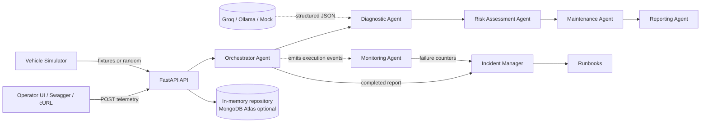
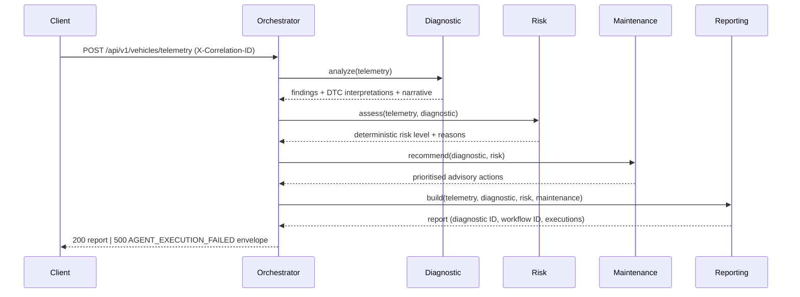

# AutoGuard AI — Architecture

Status: **Phases 1–4 complete** (foundation, telemetry ingestion, the multi-agent
workflow, monitoring and incidents). Later phases are marked *planned*.

## 1. Goals and non-goals

**Goals**

- Process simulated vehicle telemetry through a supervised multi-agent workflow.
- Produce deterministic, explainable risk classifications and maintenance advice.
- Make every request traceable end-to-end with one correlation ID.
- Detect agent failures, raise incidents and apply runbooks — without hiding failures.
- Be testable offline (no API key) and deployable as a container.

**Non-goals**

- Real vehicle integration, safety certification or validated automotive diagnosis.
- Training ML models on real fleet data.
- Microservice decomposition or Kubernetes.

## 2. System context



The **Monitoring Agent observes** agent executions; it is not a node in the vehicle
diagnosis chain. A failure in diagnosis cannot disable monitoring, and monitoring
failures are logged without masking the diagnostic result.

### Telemetry contract (implemented)

```json
{
  "vehicle_id": "VH-003",
  "timestamp": "2026-10-30T10:46:47Z",
  "status": "driving",
  "sensors": {
    "engine_temperature_c": 122.92,
    "battery_voltage_v": 10.92,
    "engine_vibration_mm_s": 8.95
  },
  "error_codes": ["P0217", "P0301"]
}
```

Validation rules enforced at the API boundary:

- `vehicle_id` must exist in the 5-vehicle simulated fleet (otherwise
  `404 VEHICLE_NOT_FOUND`);
- timestamps must be timezone-aware and at most 5 minutes in the future;
- sensor values must be finite and inside broad physical bounds — outside values are
  rejected as corrupt, while `null` means "sensor unavailable" and is accepted;
- DTCs use the `[PCBU]` + 4 hex format, are upper-cased and de-duplicated;
- unknown fields are rejected (`extra="forbid"`).

Scenarios (exact fixtures, optional seeded jitter): `normal`, `warning`, `critical`,
`sensor_failure`. Ingestion is stored in a bounded in-memory repository (default 1000
records) behind `TelemetryRepository`; records expose `telemetry_id`, `correlation_id`,
`received_at` and the validated frame. Ingestion runs the workflow and returns the
completed diagnostic report.

## 3. Layered structure

| Layer | Package | Responsibility |
| ----- | ------- | -------------- |
| Transport | `app/api` | HTTP routing, validation, error envelopes |
| Orchestration | `app/orchestration` | LangGraph graph, shared state, retries |
| Domain agents | `app/agents` | Diagnostic, Risk, Maintenance, Reporting |
| Observation | `app/monitoring` | Traces, statistics, failure detection |
| Response | `app/incidents` | Incident records, runbook selection, escalation |
| Persistence | `app/services` | Repository interfaces + in-memory implementation |
| Cross-cutting | `app/core` | Config, logging, correlation, errors, middleware |
| Contracts | `app/models` | Pydantic schemas shared by all layers |
| Simulation | `simulator` | Deterministic fixtures and random telemetry |

Dependencies point inward: agents never import FastAPI; the API never implements
diagnostic rules.

## 4. Agents

| Agent | Input | Output | Deterministic? |
| ----- | ----- | ------ | -------------- |
| Orchestrator | Telemetry payload | Workflow result + trace | Yes |
| Diagnostic | Validated telemetry | Findings, DTC interpretation, suspected faults | Hybrid (rules + LLM narrative) |
| Risk Assessment | Findings + sensor deltas | `LOW`/`MEDIUM`/`HIGH`/`CRITICAL` + reasons | **Fully deterministic** |
| Maintenance | Findings + risk | Prioritised actions with rationale | **Fully deterministic** |
| Reporting | All previous results | Structured report + correlation ID | Yes |
| Monitoring | Execution events | Traces, statistics, incidents | Yes |

**Safety rule:** the LLM may only rephrase the summary of already-computed findings. It
may not assign risk levels, compute safety scores, invent readings or claim a repair was
performed. Risk and maintenance priority are produced by code and validated by Pydantic
before leaving their agents.

## 5. Workflow (implemented)



LangGraph executes `START → diagnostic → risk → maintenance → reporting → END`. The
Orchestrator is the graph controller: it owns sequencing, the retry budget and the
execution ledger, and records its own `AgentExecution` for end-to-end timing.

### Failure path (implemented core)

1. An agent raises → `AgentRunner` records a `FAILED` execution with error type/message
   and duration.
2. The attempt is retried up to `AUTOGUARD_AGENT_MAX_RETRIES` (default 1).
3. If every attempt fails, an `AgentExecutionError` aborts the workflow with
   `AGENT_EXECUTION_FAILED`; no report is fabricated. The Diagnostics Service records an
   `AGENT_EXECUTION_FAILED` incident before re-raising.
4. LLM narrative failures are *not* agent failures: the Diagnostic Agent falls back to a
   deterministic summary and the report records `LLM_NARRATIVE_UNAVAILABLE`; a
   `LLM_PROVIDER_FAILURE` incident is raised at medium severity.
5. A deterministic `CRITICAL` risk classification raises a `CRITICAL_VEHICLE_RISK`
   incident linked to the `high_risk_vehicle` runbook. Invalid telemetry never reaches
   the workflow, so it is a `422` boundary error and not an incident.
6. Every incident stores the correlation ID, vehicle, diagnostic/workflow IDs and the
   ordered runbook steps. Lifecycle changes are out of scope for the demo (all incidents
   start `open`).

## 6. State and contracts (implemented)

The LangGraph state is a typed `TypedDict` carrying:

```text
telemetry_record, workflow_id, diagnostic, risk, maintenance, report
```

Execution records live on the per-invocation `AgentRunner` rather than in graph state,
so attempts from a node that ultimately failed are still retained. Agents exchange
**only Pydantic-validated objects**. No agent reads mutable global state, which keeps each
node independently unit-testable.

## 7. Observability contract

Current (Phases 1–4):

- `X-Correlation-ID` accepted/generated per request, returned on every response.
- JSON logs include `timestamp`, `level`, `logger`, `message`, `correlation_id`,
  `service`, `environment` plus event-specific fields (`path`, `duration_ms`, `status_code`).
- Error envelope always embeds the correlation ID.
- Every agent attempt produces an `AgentExecution` (`agent_name`, `workflow_id`,
  `correlation_id`, `status`, `attempt`, timings, error type/message) attached to the report.
- The Monitoring Agent receives every attempt through an observer and keeps a bounded
  ledger. `GET /api/v1/monitoring` exposes workflow counters (started/completed/degraded/
  failed), success rate, average duration and per-agent totals, failures, retries and
  average duration.
- `GET /api/v1/incidents` exposes derived incidents with severity, status, runbook and
  correlation/workflow/diagnostic links, filterable by `status`, `severity` and
  `vehicle_id`.

## 8. Persistence

Phase 2+ uses repository interfaces (`TelemetryRepository`, `DiagnosticRepository`) with
bounded in-memory implementations. Incident and monitoring state use the same pattern
(bounded in-process stores behind `IncidentManager` and `MonitoringAgent`). MongoDB Atlas
can be enabled later without changing agents or routes. In-memory state is intentionally
process-local and resets on restart; this limitation is documented rather than hidden.

## 9. Configuration and security

- `pydantic-settings` validates all configuration at startup (`AUTOGUARD_*`).
- Secrets use `SecretStr`; the Groq key is required only when that provider is selected.
- Client correlation IDs are allow-listed (no whitespace/control characters) to prevent
  log injection.
- CORS is disabled unless explicit origins are configured.
- Unexpected exceptions return a generic 500 envelope; internal details stay in logs.

## 10. Key decisions

| # | Decision | Rationale |
| - | -------- | --------- |
| 1 | Modular monolith | Simpler to test, deploy and demonstrate than microservices |
| 2 | LangGraph for orchestration | Explicit state machine, retries and conditional edges; inspectable flow |
| 3 | Deterministic risk engine | Safety-critical classification must not be LLM-generated |
| 4 | Default `mock` LLM | Offline CI, reproducible tests, no key leakage |
| 5 | Correlation ID in `ContextVar` | Zero-argument propagation across async agents |
| 6 | Single error envelope | Predictable client handling and easier monitoring |
| 7 | In-memory repositories behind interfaces | Fast MVP, MongoDB optional later |
| 8 | JSON logs by default | Matches observability requirements; console mode for local dev |

## 11. Phase plan

1. **Foundation (done):** settings, logging, correlation IDs, errors, health, docs.
2. **Telemetry (done):** simulator, strict validation, repositories, fleet/telemetry API.
3. **Multi-agent workflow (done):** LangGraph graph, deterministic risk engine, mock/Groq/Ollama narrative clients, report persistence and diagnostics API.
4. **Monitoring & incidents (done):** passive Monitoring Agent, aggregated statistics, three incident triggers and three runbooks, `/monitoring` and `/incidents` APIs.
5. **Agent cards & governance (done):** one card per agent plus change-control, prompt, data and incident policy.
6. Unit/integration/API/failure tests, ≥80% coverage.
7. GitHub Actions CI (lint, tests, coverage, image build).
8. Dockerfile, compose, local container validation.
9. Render deployment (verified, not assumed).
10. Final docs and demonstration.
