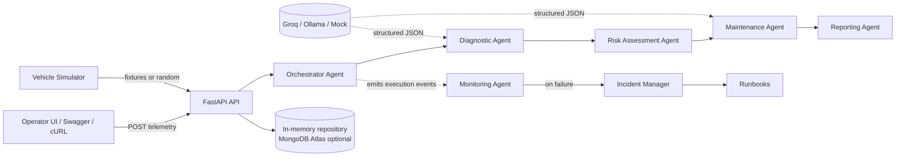
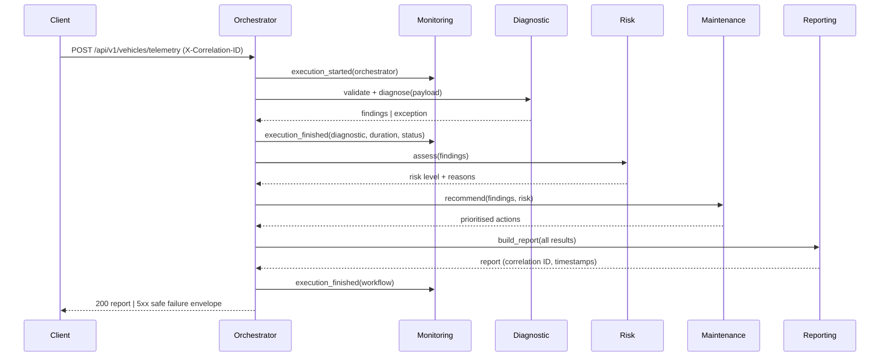

# AutoGuard AI — Architecture

Status: **Phases 1–2 complete** (foundation + telemetry ingestion). Later phases are
marked *planned*.

## 1. Goals and non-goals

**Goals**

- Process simulated vehicle telemetry through a supervised multi-agent workflow.
- Produce deterministic, explainable risk classifications and maintenance advice.
- Make every request traceable end-to-end with one correlation ID.
- Detect agent failures, raise incidents and apply runbooks — without hiding failures.
- Be testable offline (no API key) and deployable as a container.

**Non-goals**

- Real vehicle integration, safety certification or validated automotive diagnosis.
- Training ML models on real fleet data.
- Microservice decomposition or Kubernetes.

## 2. System context



The **Monitoring Agent observes** agent executions; it is not a node in the vehicle
diagnosis chain. A failure in diagnosis cannot disable monitoring, and monitoring
failures are logged without masking the diagnostic result.

### Telemetry contract (implemented)

```json
{
  "vehicle_id": "VH-003",
  "timestamp": "2026-10-30T10:46:47Z",
  "status": "driving",
  "sensors": {
    "engine_temperature_c": 122.92,
    "battery_voltage_v": 10.92,
    "engine_vibration_mm_s": 8.95
  },
  "error_codes": ["P0217", "P0301"]
}
```

Validation rules enforced at the API boundary:

- `vehicle_id` must exist in the 5-vehicle simulated fleet (otherwise
  `404 VEHICLE_NOT_FOUND`);
- timestamps must be timezone-aware and at most 5 minutes in the future;
- sensor values must be finite and inside broad physical bounds — outside values are
  rejected as corrupt, while `null` means "sensor unavailable" and is accepted;
- DTCs use the `[PCBU]` + 4 hex format, are upper-cased and de-duplicated;
- unknown fields are rejected (`extra="forbid"`).

Scenarios (exact fixtures, optional seeded jitter): `normal`, `warning`, `critical`,
`sensor_failure`. Ingestion is stored in a bounded in-memory repository (default 1000
records) behind `TelemetryRepository`; records expose `telemetry_id`, `correlation_id`,
`received_at` and the validated frame. Phase 3 adds the diagnostic report to this
response.

## 3. Layered structure

| Layer | Package | Responsibility |
| ----- | ------- | -------------- |
| Transport | `app/api` | HTTP routing, validation, error envelopes |
| Orchestration | `app/orchestration` | LangGraph graph, shared state, retries |
| Domain agents | `app/agents` | Diagnostic, Risk, Maintenance, Reporting |
| Observation | `app/monitoring` | Traces, statistics, failure detection |
| Response | `app/incidents` | Incident records, runbook selection, escalation |
| Persistence | `app/services` | Repository interfaces + in-memory implementation |
| Cross-cutting | `app/core` | Config, logging, correlation, errors, middleware |
| Contracts | `app/models` | Pydantic schemas shared by all layers |
| Simulation | `simulator` | Deterministic fixtures and random telemetry |

Dependencies point inward: agents never import FastAPI; the API never implements
diagnostic rules.

## 4. Agents

| Agent | Input | Output | Deterministic? |
| ----- | ----- | ------ | -------------- |
| Orchestrator | Telemetry payload | Workflow result + trace | Yes |
| Diagnostic | Validated telemetry | Findings, DTC interpretation, suspected faults | Hybrid (rules + LLM narrative) |
| Risk Assessment | Findings + sensor deltas | `LOW`/`MEDIUM`/`HIGH`/`CRITICAL` + reasons | **Fully deterministic** |
| Maintenance | Findings + risk | Prioritised actions with rationale | Hybrid (LLM text, rules for priority) |
| Reporting | All previous results | Structured report + correlation ID | Yes |
| Monitoring | Execution events | Traces, statistics, incidents | Yes |

**Safety rule:** the LLM may describe findings and maintenance rationale, but it may not
assign risk levels, compute safety scores or claim a repair was performed. Those fields
are produced by code and validated by Pydantic before leaving the Risk agent.

## 5. Workflow (target)



### Failure path

1. Agent raises → Monitoring records status `FAILED`, error type/message and duration.
2. Incident ID is generated and linked to the correlation ID.
3. A runbook is selected (`agent_failure`, `llm_provider_failure`, `invalid_telemetry`).
4. One safe retry is attempted for idempotent steps only.
5. If the retry fails, the workflow returns a failure (never a fabricated report) and
   the incident is escalated and stored.

## 6. State and contracts (planned)

The LangGraph state will be a typed `TypedDict` carrying:

```text
correlation_id, workflow_id, telemetry, diagnostic, risk, maintenance,
report, trace[], incidents[], status, error
```

Agents exchange **only Pydantic-validated JSON-compatible objects**. No agent reads
mutable global state, which keeps each node independently unit-testable.

## 7. Observability contract

Current (Phase 1):

- `X-Correlation-ID` accepted/generated per request, returned on every response.
- JSON logs include `timestamp`, `level`, `logger`, `message`, `correlation_id`,
  `service`, `environment` plus event-specific fields (`path`, `duration_ms`, `status_code`).
- Error envelope always embeds the correlation ID.

Planned (Phase 4):

- One in-memory execution record per agent: `agent`, `correlation_id`, `status`
  (`STARTED`/`SUCCESS`/`FAILED`/`RETRYING`), `started_at`, `ended_at`,
  `execution_time_ms`, `error`, `retry_count`.
- Aggregated endpoint statistics: totals, success rate, average duration, failures per
  agent, active incidents.

## 8. Persistence

Phase 2+ uses repository interfaces (`DiagnosticRepository`, `IncidentRepository`,
`TraceRepository`) with an in-memory implementation. MongoDB Atlas can be enabled later
without changing agents or routes. In-memory state is intentionally process-local and
resets on restart; this limitation is documented rather than hidden.

## 9. Configuration and security

- `pydantic-settings` validates all configuration at startup (`AUTOGUARD_*`).
- Secrets use `SecretStr`; the Groq key is required only when that provider is selected.
- Client correlation IDs are allow-listed (no whitespace/control characters) to prevent
  log injection.
- CORS is disabled unless explicit origins are configured.
- Unexpected exceptions return a generic 500 envelope; internal details stay in logs.

## 10. Key decisions

| # | Decision | Rationale |
| - | -------- | --------- |
| 1 | Modular monolith | Simpler to test, deploy and demonstrate than microservices |
| 2 | LangGraph for orchestration | Explicit state machine, retries and conditional edges; inspectable flow |
| 3 | Deterministic risk engine | Safety-critical classification must not be LLM-generated |
| 4 | Default `mock` LLM | Offline CI, reproducible tests, no key leakage |
| 5 | Correlation ID in `ContextVar` | Zero-argument propagation across async agents |
| 6 | Single error envelope | Predictable client handling and easier monitoring |
| 7 | In-memory repositories behind interfaces | Fast MVP, MongoDB optional later |
| 8 | JSON logs by default | Matches observability requirements; console mode for local dev |

## 11. Phase plan

1. **Foundation (done):** settings, logging, correlation IDs, errors, health, docs.
2. **Telemetry (done):** simulator, strict validation, repositories, fleet/telemetry API.
3. LangGraph agents + LLM abstraction (mock/Groq/Ollama).
4. Monitoring, incidents, runbooks.
5. Agent Cards & governance docs.
6. Unit/integration/API/failure tests, ≥80% coverage.
7. GitHub Actions CI (lint, tests, coverage, image build).
8. Dockerfile, compose, local container validation.
9. Render deployment (verified, not assumed).
10. Final docs and demonstration.
